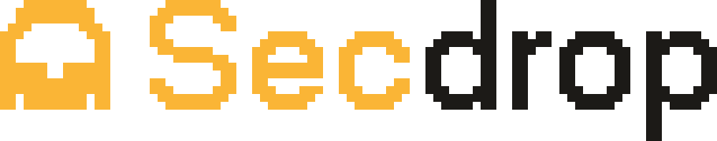
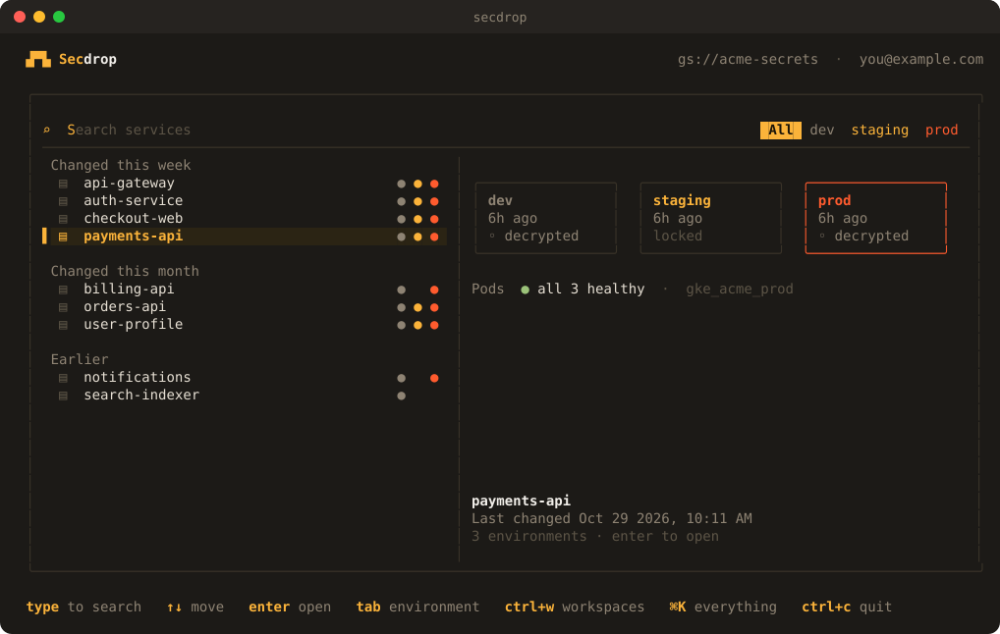
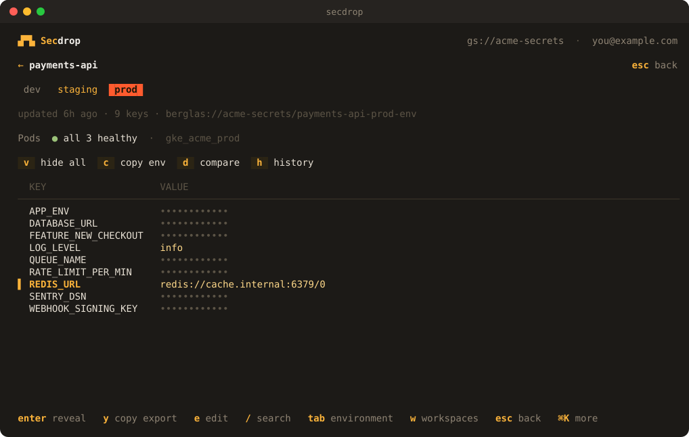
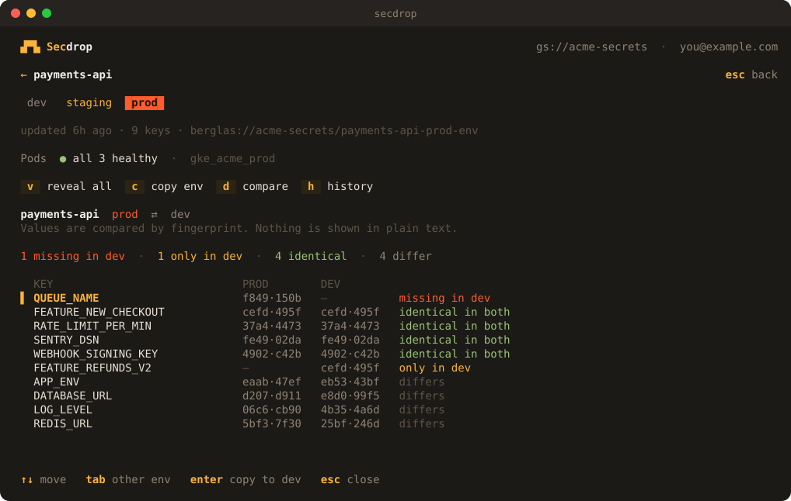
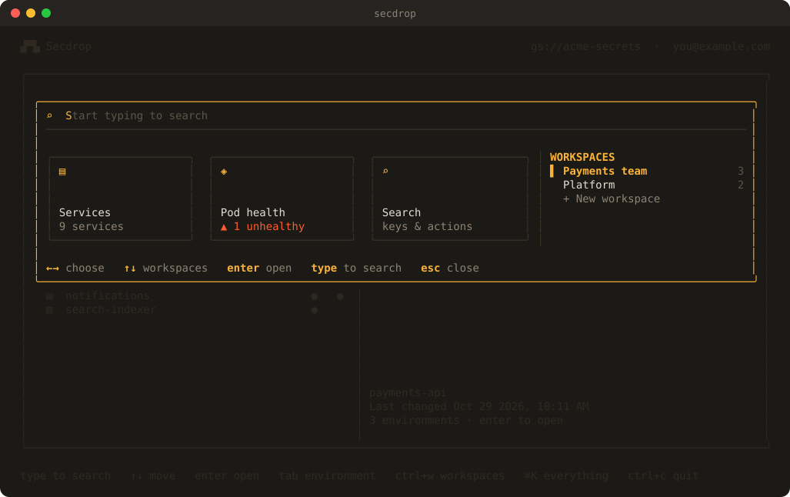

<p align="center">
  <picture>
    <source media="(prefers-color-scheme: dark)" srcset="assets/logo-dark.svg">
    
  </picture>
</p>

<h3 align="center">Your team's secrets, one keystroke away.</h3>

<p align="center">
  A fast, keyboard-first terminal app for <a href="https://github.com/GoogleCloudPlatform/berglas">Berglas</a> secrets on Google Cloud.<br>
  Find any service, see its keys safely, and change them with confidence.
</p>

<p align="center">
  <a href="https://github.com/dumbprism19/secdrop/actions/workflows/ci.yml"></a>
  <a href="https://pkg.go.dev/github.com/dumbprism19/secdrop"></a>
  <a href="LICENSE"></a>
</p>

<p align="center">
  <code>go install github.com/dumbprism19/secdrop/cmd/secdrop@latest</code>
</p>

<p align="center">
  
</p>

---

## Why secdrop

Berglas is a great way to keep secrets in Google Cloud. Working with them day to day is
less great: you need to remember bucket and object names, type long `berglas access`
commands, scroll through raw output, and copy values around by hand.

secdrop turns that into a few keystrokes:

- **No paths to remember.** It finds the buckets you can access across all your projects
  and shows your services and their environments. Just start typing.
- **Safe by default.** Values stay masked until you ask to see them, hide again on their
  own, and never end up in your terminal history.
- **Changes you can trust.** Every edit is reviewed before it's saved, and a save only
  goes through if nobody else changed the secret in the meantime.
- **Everything in one place.** Compare environments, look back through history, check
  pod health and jump between the services you use most, without leaving the keyboard.

## A quick tour

### Find any service in a keystroke

The home screen lists every service, grouped by when it last changed, with a dot for each
environment it has. Type to filter, press <kbd>enter</kbd> to open. The preview on the right
shows each environment and the health of the service's pods, without decrypting anything.

### See, copy and edit secrets safely

<p align="center">
  
</p>

Open a service to see its keys, one environment at a time. Reveal a single value or all of
them, and they mask themselves again after 20 seconds. Copy one key as a ready-to-paste
`export KEY=value` line, or the whole env file. The clipboard is cleared after 30 seconds.

Adding keys is just as quick: paste `export KEY=value` lines, or a whole block of them,
and secdrop fills everything in for you.

### Compare environments without exposing values

<p align="center">
  
</p>

Line up dev against prod (or any two environments) and see which keys are missing, which
differ and which are identical, all by fingerprint. No value is ever shown in plain text.
Found a key that's missing in prod? Press <kbd>enter</kbd> to copy it across, with a review
step first.

### Everything else is one shortcut away

<p align="center">
  
</p>

Press <kbd>⌘K</kbd> (or <kbd>ctrl</kbd>+<kbd>k</kbd>) for services, pod health and search
across keys and actions. Your **workspaces** sit right beside them: save the handful of
services you work with as "Payments team" and open them without searching.

### And a lot more

| | |
|---|---|
| 🕘 **History and undo** | Every saved version, which keys changed, who saved it, and a one-step restore. |
| 🩺 **Pod health** | Each service shows its pods from your current `kubectl` context, problems first. |
| 🗂 **Workspaces** | Named shortlists of services, a key press away with <kbd>w</kbd>. |
| ⚡ **Use secrets in your apps** | `secdrop run my-service dev -- npm start` starts any command with the secrets loaded, with nothing written to disk. |
| 🔄 **Always up to date** | secdrop updates itself when a new release is out and tells you which version you're on. |
| 🎨 **Built for the terminal** | Smooth, restrained motion that turns off with `--no-motion`, and works over SSH. |

## Get started

**1. Install** (macOS or Linux, Go 1.21 or newer):

```sh
go install github.com/dumbprism19/secdrop/cmd/secdrop@latest
```

This puts `secdrop` in `~/go/bin`. If your shell can't find it, add that folder to your `PATH`:

```sh
echo 'export PATH="$HOME/go/bin:$PATH"' >> ~/.zshrc && source ~/.zshrc
```

**2. Run it:**

```sh
secdrop
```

**3. Sign in and pick your bucket.** If you aren't signed in to Google Cloud, press
<kbd>enter</kbd> and secdrop opens your browser to sign in with `gcloud`. The first time, it
finds the Berglas buckets you can access; pick yours and it's remembered from then on.

That's it. You'll need the [gcloud CLI](https://cloud.google.com/sdk/docs/install) installed,
and access to your team's secrets (see [Permissions](#permissions)).

## Keyboard

| Key | What it does |
| --- | --- |
| type · <kbd>↑</kbd> <kbd>↓</kbd> · <kbd>enter</kbd> · <kbd>esc</kbd> | Search, move, open, go back |
| <kbd>tab</kbd> | Switch environment |
| <kbd>⌘K</kbd> / <kbd>ctrl</kbd>+<kbd>k</kbd> | Services, pod health, search and every other action |
| <kbd>w</kbd> (<kbd>ctrl</kbd>+<kbd>w</kbd> on the home screen) | Your workspaces |
| <kbd>enter</kbd> · <kbd>v</kbd> | Reveal one value · reveal them all |
| <kbd>y</kbd> · <kbd>c</kbd> | Copy as `export KEY=value` · copy the whole env file |
| <kbd>e</kbd> · <kbd>/</kbd> | Edit a value · search keys |
| <kbd>d</kbd> · <kbd>h</kbd> | Compare environments · history |
| <kbd>?</kbd> · <kbd>ctrl</kbd>+<kbd>c</kbd> | Help · quit |

On macOS, terminals keep <kbd>⌘K</kbd> for themselves. Run `secdrop setup-keys` once and
Cursor or VS Code will pass it to secdrop (only while secdrop is open, so it still clears your
shell). It also prints the setting for Ghostty, kitty, WezTerm and iTerm2.

## From the command line

```sh
secdrop run payments-api dev -- npm start       # run a command with the secrets loaded
secdrop export payments-api dev -o .env.local   # write an env file only you can read
secdrop --pick                                   # choose a different bucket
secdrop --bucket NAME                            # open a specific bucket
```

`run` and `export` use the bucket you picked last, accept `production` for `prod`, and never
update or prompt, so they're safe in scripts.

## Secure by design

secdrop handles your most sensitive values, so it's careful with them:

- **It acts as you.** It uses your own Google Cloud sign-in and permissions, has no service
  account of its own, and stores no tokens.
- **Values stay in memory.** Lists hold names only. A value is decrypted when you open a
  service and is never written to disk unless you export it.
- **Nothing leaks by accident.** Secret values can't be printed into logs or error messages,
  and the app runs in a separate screen, so nothing remains in your scrollback.
- **No silent overwrites.** Every write checks that the secret is still the version you
  opened, so a teammate's change is never lost.
- **Comparisons reveal nothing.** Environments are compared by fingerprints made with a key
  that exists only for that session.
- **Everything is on the record.** Opening a secret is a real Cloud KMS decrypt under your
  name and appears in your project's audit logs like any other access.

Found a security issue? Please report it privately, as described in [SECURITY.md](SECURITY.md).

## Permissions

secdrop can only do what your Google Cloud account can do.

| To | You need |
| --- | --- |
| View secrets | `roles/storage.objectViewer` on the bucket and `roles/cloudkms.cryptoKeyDecrypter` on the Berglas key |
| Edit, add, delete or restore | `roles/storage.objectAdmin` on the bucket and `roles/cloudkms.cryptoKeyEncrypter` on the key |
| Find buckets automatically | Permission to list projects and buckets (otherwise, type the bucket name) |
| See who read or changed a secret | Cloud Storage Data Access audit logs, and `roles/logging.privateLogViewer` |
| Keep older versions for history | Object Versioning on the bucket |
| Pod health | `kubectl` access to list pods in your current context |

<details>
<summary><b>Configuration</b></summary>

<br>

Settings live in `~/.config/secdrop/config.json`. They hold names only, never secrets.

| Setting | What it does |
| --- | --- |
| `--no-motion` or `SECDROP_NO_MOTION=1` | Turn off animation |
| `--no-auto-update`, `SECDROP_NO_AUTO_UPDATE=1` or `"no_auto_update": true` | Don't install new releases automatically |
| `"shared": ["SENTRY_DSN"]` | Keys that are meant to be identical in every environment, so compare doesn't flag them |

**Updates.** When secdrop starts, it checks for a newer release (at most once an hour, and
never for more than 2 seconds). If it was installed with `go install`, it updates itself and
restarts; otherwise the home screen tells you how to update. `run` and `export` never update.

</details>

<details>
<summary><b>FAQ</b></summary>

<br>

**Will secdrop change a secret without asking?**
No. Every change goes through a review screen that says exactly what will be written, and
production is highlighted in red.

**Does it work for my organization?**
Yes, if your secrets are stored with Berglas in Cloud Storage. Names like
`payments-api-prod-env`, `payments_api_production` and `payments-api/dev.env` are all
understood as a service and an environment.

**What about Berglas with Secret Manager (`sm://`)?**
Not yet. Only the Cloud Storage backend is supported today.

**Windows?**
Not yet. secdrop runs on macOS and Linux.

**Do I need the `berglas` command installed?**
No. secdrop includes Berglas, so you only need secdrop and `gcloud`.

</details>

## Contributing

Issues and pull requests are welcome.

```sh
git clone https://github.com/dumbprism19/secdrop.git && cd secdrop
go test ./...
go build -o bin/secdrop ./cmd/secdrop && ./bin/secdrop
```

The code is organised by job under `internal/`: `ui` for the screens, `store` for Berglas and
Cloud Storage, `dotenv` for `.env` files, `secret` for the value type that won't print itself,
`kube` for pod health and `update` for self-updates. The screenshots in this README are
rendered from sample data with `scripts/ansi2svg.py`; see `internal/ui/shots_test.go`.

## License

Copyright 2026 dumbprism. Licensed under the [Apache License 2.0](LICENSE). See [NOTICE](NOTICE).
